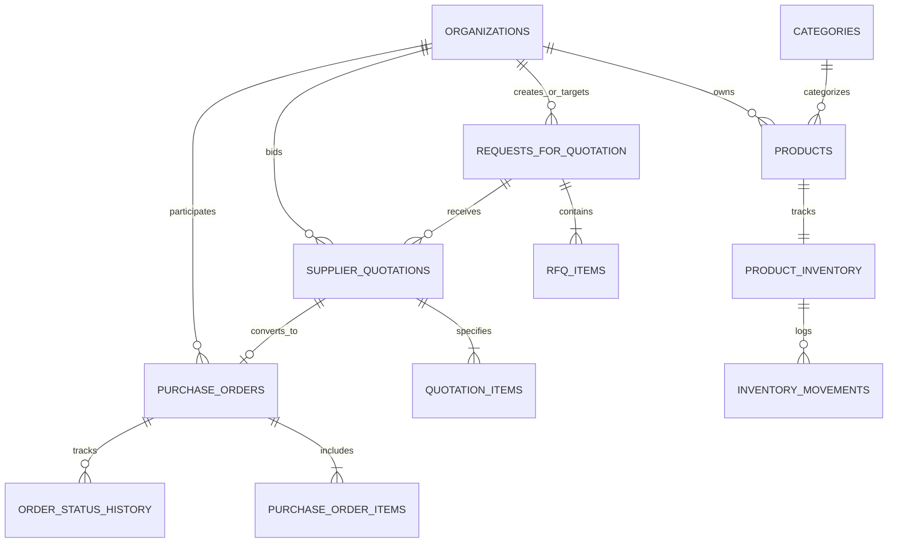
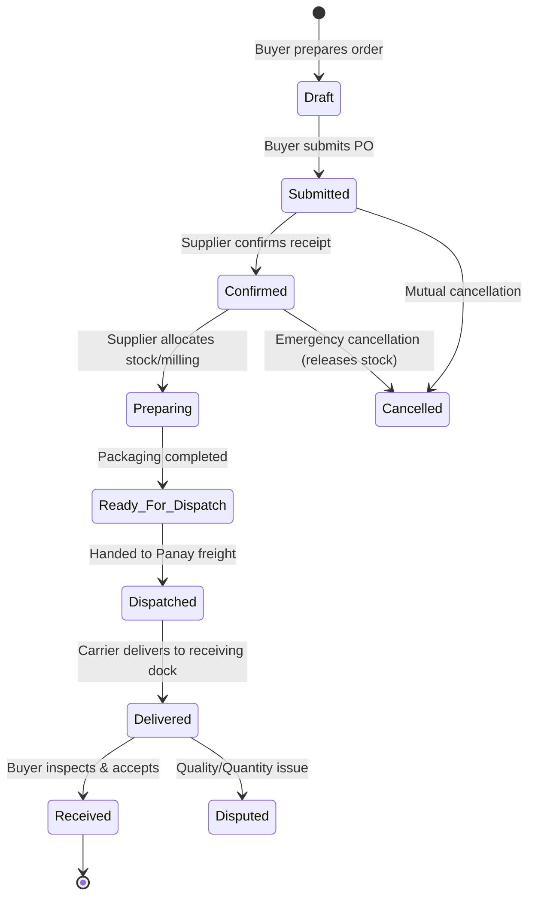

# AntiqueSupply — System Architecture & Technical Specifications

**Tagline:** Local Products. Bigger Markets.  
**Platform Domain:** B2B Marketplace, Procurement Management & Supplier Operations Platform  
**Target Geographies:** Antique (Panay Island, Western Visayas, Philippines), Boracay Island (Malay, Aklan), Iloilo City, Roxas City.

---

## 1. Architectural Principles

1. **Organization-Based Multi-Tenancy**: Accounts belong to legal entities (cooperatives, associations, resorts, restaurants, retail grocers) rather than isolated individuals.
2. **Single Database of Truth**: Both the Next.js web portal and native Kotlin Android application communicate with the same versioned PostgreSQL backend and shared domain schemas (`@antiquesupply/shared-schemas`).
3. **Atomic Concurrency & Inventory Locking**: Stock reservations are committed in row-level exclusive transactions to prevent overselling of high-demand local products (Muscovado sugar, Patadyong textiles, VCO).
4. **Explicit State Machine**: Purchase orders cannot arbitrarily change state; each transition is validated server-side against authorized routes and recorded in an immutable audit history log.
5. **Offline Resiliency for Rural Producers**: The native Android application incorporates local Room database caching (`draft_rfqs`, `cached_products`) ensuring operations can proceed even in areas with intermittent cellular connectivity in upland and coastal Antique municipalities.

---

## 2. PostgreSQL Schema & Domain Model

---

## 3. Order Lifecycle State Machine

---

## 4. Security & Philippine Data Privacy Act (RA 10173) Compliance

- **Least-Privilege Tenant Isolation**: Row Level Security (RLS) policies prevent suppliers from viewing competitor quotation amounts or uninvited RFQ bids.
- **Document Confidentiality**: Sensitive business permits (CDA registration, BIR Form 2303, Mayor's Permits) are restricted to platform administrators and the owning cooperative.
- **Financial Precision**: All monetary calculations utilize PostgreSQL `NUMERIC(14, 2)` or strict fixed-decimal logic to avoid floating-point errors.
- **Audit Logging**: Every state transition, price change, and verification action records the actor's user profile, timestamp, and notes.
